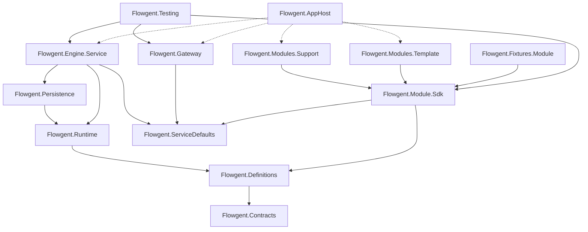

# Design Document: LLM Flow Modules (Flowgent platform)

## Overview

The single-purpose support backend becomes **Flowgent**, a distributed platform that runs LLM workflows described in YAML:

- **Gateway** (`Flowgent.Gateway`): YARP reverse proxy, the only public entry point (port 5080).
- **Engine Service** (`Flowgent.Engine.Service`): domain-agnostic. Pulls module packages, validates and compiles workflow definitions into Microsoft Agent Framework workflow graphs, runs them, and owns runs, events, the inbox, human input, LLM access (Demo / OpenAI-compatible), telemetry and the gRPC run stream.
- **Module Services** (one per module, built on `Flowgent.Module.Sdk`): own and publish their definitions (`module.yaml`, workflows, prompts, schemas, samples), expose Tools and domain endpoints.
- **Dashboard**: generic React console, calls only the gateway.
- **AppHost** (`Flowgent.AppHost`, .NET Aspire): starts everything with one command, wires addresses, shows logs/traces/metrics.

The support pipeline is ported to `modules/support` as YAML, with the same outcomes for every scenario, and is the regression suite of the platform. `modules/_template` and a test-only fixture module prove that a new module needs no engine, gateway or dashboard change.

### Key design decisions

| Topic | Decision | Rationale |
|-------|----------|-----------|
| Workflow format | Own YAML format, compiled to an Agent Framework `WorkflowBuilder` graph | Agent Framework declarative workflows need Foundry agents and only allow custom code as leaf calls |
| Executors | One generic `StepExecutor` per step, created **per run** and bound to a `RunContext` | Isolation between runs; the framework requires exclusive workflow ownership |
| Messages | A single `StepMessage(NextStepId)` type; edges conditioned on `NextStepId == target` | Transitions are evaluated in the step (first true condition), the graph only routes |
| Expressions / templates | Scriban (sandboxed: no template loader, loop/recursion/regex limits, only JSON data objects) | Mature, fast, supports both templates and expressions, rich built-ins |
| YAML parsing | YamlDotNet representation model → `JsonNode` + line map → JSON Schema validation → `System.Text.Json` model | One JSON Schema serves editors and engine validation; errors carry line numbers |
| JSON Schema | JsonSchema.Net (draft 2020-12) | Validates inputs, LLM outputs, Tool outputs and the definition format |
| Module code | Never loaded by the engine; custom logic runs in the module service as HTTP Tools | Process isolation, independent deployment |
| Definitions ownership | Module publishes `GET /_module/package` (raw files + version hash); engine polls with ETag | Pull model: engine startup never depends on modules |
| Hosting in tests | Every service exposes `XxxHost.Create(options, configure)`; tests run all services in-process on `TestServer` | Fast, deterministic multi-service tests without Aspire/DCP |
| Demo mode | Demo responses declared in YAML per `llm` step and passed to `DemoChatClient` via `ChatOptions.AdditionalProperties` | Latency, usage and telemetry stay identical to real calls |
| Persistence | EF Core InMemory in the engine (runs, events, inbox) | Same as today, SQL-ready |

## Architecture

### Topology

```mermaid
graph LR
    Browser[Dashboard<br/>Vite :5173] -->|/api/**, gRPC-Web| GW[Gateway<br/>YARP :5080]
    Client[HTTP clients / .http] --> GW
    GW -->|/api/engine/**<br/>/flowgent.RunMonitor/**| ENG[Engine Service]
    GW -->|/api/modules/support/**<br/>/api/support/**| SUP[Support Module Service]
    GW -->|/api/modules/{id}/**| MOD[Other Module Services]
    ENG -->|GET /_module/package<br/>POST /_module/tools/{name}| SUP
    ENG --> MOD
    SUP -->|POST /api/engine/workflows/{id}/runs| ENG
    ENG -->|IChatClient| LLM[(Demo / OpenAI-compatible)]
    ENG -->|http steps| EXT[(External APIs)]
    HOST[Aspire AppHost] -. starts & wires .-> GW & ENG & SUP & MOD & Browser
```

Service-to-service calls go directly between services (service discovery), never through the gateway. All services use `Flowgent.ServiceDefaults` (health, OpenTelemetry, resilience, service discovery).

### Project dependencies



Rules enforced by `Flowgent.Architecture.Tests` (project-file inspection + NetArchTest):

- `Contracts` has no project references. `Definitions` references only `Contracts`.
- Engine projects (`Contracts`, `Definitions`, `Runtime`, `Persistence`, `Engine.Service`) and `Gateway` never reference anything under `modules/` or `Fixtures/`, and contain no type in a `Flowgent.Modules.*` namespace.
- Module service projects reference only `Flowgent.Module.Sdk`, `Flowgent.Contracts`, `Flowgent.Definitions`, `Flowgent.ServiceDefaults`; never `Runtime`, `Persistence`, `Engine.Service`, `Gateway`, `Testing`.
- `Runtime` and `Definitions` do not depend on ASP.NET Core.
- No source file in engine projects mentions support-domain terms (`IncomingEmail`, `IssueCategory`, `TeamRouter`, `/emails`).

### Repository layout

```
Flowgent.slnx                      # single solution (backend + modules + tests)
Directory.Build.props / Directory.Packages.props / nuget.config / .editorconfig / global.json   # moved to repo root
backend/
├── schemas/                       # JSON Schemas of the YAML formats (editors + engine)
│   ├── module.schema.json
│   ├── workflow.schema.json
│   └── samples.schema.json
├── protos/run_monitor.proto       # gRPC contract (engine + dashboard codegen)
├── src/
│   ├── Engine/
│   │   ├── Flowgent.Contracts/    # HTTP DTOs: module package, tools, intake, engine API
│   │   ├── Flowgent.Definitions/  # YAML model, loader, validator, Scriban expressions, JSON Schema helpers
│   │   ├── Flowgent.Runtime/      # compiler, step executors, run orchestrator, human input, inbox processor,
│   │   │                          #   module catalog/client, LLM (chat client, demo, telemetry)
│   │   └── Flowgent.Persistence/  # EF Core InMemory: runs, events, inbox
│   ├── Services/
│   │   ├── Flowgent.Engine.Service/   # /api/engine/*, gRPC RunMonitor, hosted services
│   │   └── Flowgent.Gateway/          # YARP, config-driven routes, 503 problem details, correlation id
│   ├── Sdk/
│   │   ├── Flowgent.Module.Sdk/   # /_module/* endpoints, tools, offline validation, engine client
│   │   └── Flowgent.Testing/      # in-process platform harness for module and platform tests
│   └── AppHost/
│       ├── Flowgent.AppHost/
│       └── Flowgent.ServiceDefaults/
└── tests/
    ├── Flowgent.Engine.Tests/         # unit + FsCheck property tests of engine libraries and service
    ├── Flowgent.Gateway.Tests/
    ├── Flowgent.Architecture.Tests/
    ├── Flowgent.Integration.Tests/    # multi-module, module down, gateway, end-to-end
    └── Fixtures/Flowgent.Fixtures.Module/   # test-only module service + definition
modules/
├── _template/
│   ├── definition/{module.yaml, workflows/, prompts/, samples/, schemas/}
│   ├── service/Flowgent.Modules.Template.csproj (+ Program.cs, Tools/)
│   ├── tests/Flowgent.Modules.Template.Tests.csproj
│   ├── docs/ and README.md
└── support/
    ├── definition/{module.yaml, workflows/support-email.yaml, prompts/, schemas/, samples/scenarios.yaml}
    ├── service/Flowgent.Modules.Support.csproj (+ Program.cs, Tools/, Endpoints/, support.http)
    ├── tests/Flowgent.Modules.Support.Tests.csproj
    ├── dummy-apps/application-a/ and application-b/   # moved from DummyApps/
    ├── docs/ and README.md
dashboard/                          # generic console
docs/                               # platform documentation only
```

Every module folder has the same layout (`definition/`, `service/`, `tests/`, `docs/`, `README.md`, optional asset folders). Demo responses live inside the workflow files (`demo:` blocks), so `definition/demo/` is only needed for large demo payloads referenced by `file:`.

Ports (launchSettings, also used by Aspire as proxy ports): gateway 5080, engine 5081, support 5082, template 5083, dashboard 5173. Inside Aspire services find each other by name (`http://engine`, `http://support`).

## Components and Interfaces

### 1. Definition formats

All three formats are YAML files validated by the JSON Schemas in `backend/schemas` (embedded in `Flowgent.Definitions`). Files start with `# yaml-language-server: $schema=<relative path>` for editor autocomplete.

#### Value conventions (all formats)

- **Inline or file**: prompts and schemas accept an inline value or `{ file: relative/path }` (relative to the module `definition/` folder; `..` outside the folder is rejected).
- **Template**: any string containing `{{ ... }}` is a Scriban template rendered against the Run_Context. A string that is exactly one `{{ expr }}` returns the **typed** value of `expr` (bool, number, object, array, null), e.g. `output: "{{ steps.generate_code }}"`. Other strings are literals.
- **Expression**: `when:` conditions are Scriban expressions without braces, e.g. `steps.classify.isCodeRelated == true`.
- **Identifiers**: module, workflow and step ids match `^[a-z][a-z0-9_-]*$` (step ids `^[a-z][a-z0-9_]*$`, so they are usable in expressions); tool names `^[a-z][a-zA-Z0-9]*\.[a-z][a-zA-Z0-9]*$` (`<module>.<name>`); agent ids are free text without whitespace.

#### Module manifest (`definition/module.yaml`)

```yaml
# yaml-language-server: $schema=../../../backend/schemas/module.schema.json
id: hello
name: Hello module
description: Minimal example module.
config:                      # free-form, exposed to templates as config.*; never secrets
  greeting: Hello
agents:
  - id: hello_writer
    name: Writer
    group: Writers           # optional grouping (support: team)
    role: Writer             # optional
    persona: A concise technical writer.
tools:
  - name: hello.wordCount
    description: Counts words in a text.
    input:  { schema: { file: schemas/word-count.input.schema.json } }
    output: { schema: { file: schemas/word-count.output.schema.json } }
    timeoutSeconds: 10       # optional, overrides the engine default for this tool
workflows:
  - workflows/hello.yaml
samples:
  - samples/hello.samples.yaml
```

#### Workflow definition (`definition/workflows/*.yaml`)

```yaml
# yaml-language-server: $schema=../../../../backend/schemas/workflow.schema.json
id: hello
version: 1
name: Hello
description: Summarises a text and asks for approval.
title: "{{ input.text | string.truncate 60 }}"     # run title template
input:
  schema:
    type: object
    required: [text]
    properties:
      text: { type: string, minLength: 1, pattern: '\S', x-multiline: true }
  errorMessage: Text is required.                  # optional top-level 400 message
start: summarize
steps:
  - id: summarize
    kind: llm
    name: Summary
    agent: hello_writer                            # telemetry attribution (default: run's assigned agent)
    temperature: 0.2
    systemPrompt: { file: prompts/summarize.system.md }
    prompt: "Summarise: {{ input.text }}"
    output:
      schema: { file: schemas/summary.schema.json }
    demo:
      output: { summary: "[Demo] {{ input.text | string.truncate 40 }}", words: 3 }
    detail: "{{ steps.summarize.summary }}"
    next: done
  - id: done
    kind: terminal
    name: Done
    outcome: success
    message: "{{ steps.summarize.summary }}"
    output: "{{ steps.summarize }}"
```

Common step fields: `id`, `kind`, `name`, optional `description`, `detail` (template for the step-completed event and the run detail), `assignAgent` (template; sets the run's assigned agent after the step, must resolve to a declared agent), and either `next: <stepId>` or `transitions:` (all non-terminal steps):

```yaml
transitions:
  - when: steps.classify.isCodeRelated     # first true condition wins (declaration order)
    to: route_team
  - to: out_of_scope                       # no condition = default
```

If no transition matches the step fails with `No transition matched after step '<id>'.`

#### Step kinds

| Kind | Settings | Output (`steps.<id>`) |
|------|----------|-----------------------|
| `llm` | `systemPrompt?`, `prompt`, `output.schema`, `temperature?`, `agent?`, `demo?` | JSON object validated against `output.schema` |
| `rule` | `value` (template), `rules: [{match: regex \| when: expr, output}]`, `ignoreCase` (default true), `onMultipleMatches: first \| {fail: msg}` (default `first`), `onNoMatch: {fail: msg} \| {output: …}` (default fail) | The matching rule's `output` (templates rendered) |
| `map` | `lookups: {name: {key: value}}`, `outputs: [{name, value} \| {name, lookup, key, onMissing?}]` evaluated in order; earlier outputs available as `output.<name>` | Object of named outputs |
| `human-input` | `review: {title, fields: [{label, value}]}` (templates), `detail?` | `{decision: "approved" \| "rejected", reason: string \| null}` |
| `tool` | `tool: <name>` (declared in manifest), `input` (object of templates), `timeoutSeconds?` | Tool response validated against the tool's output schema |
| `http` | `method`, `url` (template), `headers: {name: {secret: key} \| literal}`, `body?` (object/templates), `timeoutSeconds?` (default 30), `output.schema?` | Parsed JSON response body |
| `terminal` | `outcome: success \| failure`, `message` (template), `output?` (template) | — ends the run |

`llm` details:
- Messages: optional system message + user message (both rendered templates). `ChatOptions { Temperature, ResponseFormat = ChatResponseFormat.ForJsonSchema(schema, schemaName: <stepId>) }`.
- The response text is parsed as JSON and validated; on invalid JSON or schema errors the step fails with `LLM response for step '<id>' does not match its output schema: <first errors>`.
- The output schema root must be `type: object` with `additionalProperties: false` (OpenAI strict mode); validation rejects other roots.

`demo` (llm only), evaluated by the engine before the call:
```yaml
demo:
  output: {...}                     # static/templated output, or
  value: "{{ input.subject }} {{ input.body }}"
  rules:                            # same matching semantics as the rule step, first match wins
    - match: '\btests?\b|flaky|coverage'
      output: {...}
  default: {...}                    # used when no rule matches (required with rules)
  # or
  tool: hello.demoSummary           # Tool producing the demo output (input: {stepId, prompt, systemPrompt})
```

`http` details: header values with `secret:` are read from engine configuration `Flowgent:Secrets:<moduleId>:<key>` and never appear in API responses; non-2xx status codes, invalid JSON and timeouts fail the step.

#### Samples (`definition/samples/*.yaml`)

```yaml
samples:
  - id: hello-short
    name: Short text
    group: Examples
    workflow: hello
    description: optional
    input: { text: "Agent Framework workflows in YAML." }
```

Samples are validated against the workflow input schema unless `expectInvalid: true` (used for the support "Empty Input" sample).

### 2. Expressions and templates (`Flowgent.Definitions/Expressions`)

- `ScribanTemplate` / `ScribanExpression` wrap parsed Scriban ASTs; parsing happens at load time (Req 7.3) and errors carry the template location (file + step + field).
- A static AST walk checks `steps.<id>` references point to declared steps.
- **Run_Context** (built per evaluation from JSON, never CLR objects):
  - `input` – the run input; `steps.<id>` – outputs of completed steps; `config` – module config;
  - `run` – `{ id, moduleId, workflowId, title, agentId, agent: {id, name, group, role, persona} | null }`;
  - `output` – partial output inside a `map` step.
- Built-ins: Scriban `string.*` (contains, downcase, truncate…), `regex.*`, `array.*`, `math.*`, `object.default`, `date.*`, comparison/boolean operators, `== null`.
- Sandbox: `TemplateContext` with no `TemplateLoader` (include/import of files fails), `LoopLimit = 1000`, `RecursiveLimit = 50`, `RegexTimeOut = 1s`, `LimitToString = 100 000`, `EnableRelaxedMemberAccess = true` (missing members are null). Only `ScriptObject`/`ScriptArray` built from JSON are exposed, so there is no reflection, file, network or process access.
- Conversions: `JsonNode ⇄ ScriptObject/ScriptArray`; typed full-expression results are converted back to `JsonNode`.

### 3. Loading and validation (`Flowgent.Definitions`)

```csharp
public sealed record ModulePackage(string ModuleId, string Version, IReadOnlyDictionary<string, string> Files); // Contracts
public sealed record DefinitionError(string ModuleId, string? File, string? StepId, int? Line, string Message, DefinitionSeverity Severity);
public sealed record LoadResult(ModuleDefinition? Module, IReadOnlyList<DefinitionError> Errors);

public static class ModuleLoader
{
    public static LoadResult Load(ModulePackage package);                 // engine
    public static LoadResult LoadFromDirectory(string definitionPath);    // SDK offline validation & tests
}
```

Pipeline: YAML parse (syntax errors with line) → `JsonNode` + JSON-pointer→line map → format JSON Schema → deserialize into records (`ModuleDefinition`, `WorkflowDefinition`, `StepDefinition` subclasses per kind) → semantic checks:

1. Unique step ids; `start` exists; every transition target exists.
2. Every step reachable from `start`; at least one terminal reachable; non-terminal steps have `next` or `transitions`; terminals have none.
3. Referenced files exist inside `definition/`; JSON Schemas parse; llm output schema root is a strict object.
4. Agents (`agent`, literal `assignAgent`) and tools are declared in the manifest.
5. All templates and expressions parse; `steps.<id>` references exist.
6. Samples reference existing workflows and their inputs validate (unless `expectInvalid`).
7. Warnings (do not block loading): `llm` step without `demo`; tool declared but unused.

`ModuleDefinition` is immutable and carries `Version` (SHA-256 of the package files), so a run keeps the definition it started with.

### 4. Module SDK (`Flowgent.Module.Sdk`)

```csharp
var builder = WebApplication.CreateBuilder(args);
builder.AddServiceDefaults();
builder.AddFlowgentModule();                                // Flowgent:Module:DefinitionPath (default "../definition")
builder.Services.AddModuleTool<LocateComponentTool>("support.locateComponent");
var app = builder.Build();
app.MapFlowgentModule();                                    // /_module/*, /api/modules/{id}
app.MapDefaultEndpoints();                                  // /health, /alive
```

| Endpoint | Description |
|----------|-------------|
| `GET /_module/package` | `ModulePackage` (all definition files as text + version). `ETag: "<version>"`, `304` on `If-None-Match` |
| `POST /_module/tools/{name}` | `ToolInvocationRequest { runId, workflowId, stepId, input }` → `200 { output }`; `404` unknown tool; `400/500 { error }` on failure |
| `GET /api/modules/{id}` | Manifest summary (id, name, description, workflows) |

- `IModuleTool { Task<JsonNode?> InvokeAsync(ToolInvocation invocation, CancellationToken ct); }` and `ModuleTool<TInput, TOutput>` (typed, JSON camelCase).
- Startup: loads and validates the definition with `ModuleLoader.LoadFromDirectory`, logs errors (`Flowgent:Module:FailOnInvalidDefinition`, default `false`, so the engine can display errors) and checks every declared tool has a handler.
- `IEngineClient` (named client `flowgent-engine`, base address `Flowgent:EngineUrl`, default `http://engine`): `SubmitAsync(workflowId, input)` → `IntakeResult` (accepted with ids, invalid with errors, unavailable).
- `ModuleDefinitionAssert.IsValid(path)` for module unit tests.

### 5. Engine runtime (`Flowgent.Runtime`)

#### Module catalog

- Config: `Flowgent:Modules: [{ id, url, enabled, refreshSeconds (5), timeoutSeconds (30), retries (2) }]`.
- `ModuleCatalogService` (BackgroundService) polls each module's `/_module/package` with `If-None-Match`, never blocking engine startup.
- Module states: `Loading` (never loaded), `Available`, `Invalid` (validation errors / id conflicts), `Unavailable` (last fetch failed; definitions kept for in-flight runs).
- A new version is loaded and compiled atomically; in-flight runs keep their `ModuleDefinition` reference.
- Conflicts: manifest id ≠ configured id, a second module with the same id, or a workflow id already owned by another module → the later module becomes `Invalid` with a descriptive error.
- `IModuleCatalog`: `GetModules()`, `TryGetWorkflow(workflowId, out WorkflowHandle)` where availability is checked by callers.

#### Compilation

`WorkflowCompiler.Build(WorkflowDefinition, RunContext, StepServices)` creates, **per run**:

```csharp
var executors = definition.Steps.ToDictionary(s => s.Id, s => StepExecutorFactory.Create(s, runContext, services));
var builder = new WorkflowBuilder(executors[definition.Start]);
foreach (var step in definition.Steps)
    foreach (var target in step.TransitionTargets.Distinct())
        builder.AddEdge<StepMessage>(executors[step.Id], executors[target], m => m?.NextStepId == target);
builder.WithOutputFrom([.. definition.Steps.OfType<TerminalStep>().Select(t => executors[t.Id])]);
return builder.Build();
```

- `StepMessage(string NextStepId)` is the only message type.
- Non-terminal executors: `AddHandler<StepMessage, StepMessage>` → record `StepStarted`, run the kind handler, store output in the `RunContext`, apply `assignAgent`, record `StepCompleted` (with `detail`), evaluate transitions, return the next `StepMessage`. A `maxSteps` guard (default 100 per run) stops loops.
- Terminal executors: `AddHandler<StepMessage>` + `YieldsOutput<RunOutcome>()`; they yield `RunOutcome(Success|Failure, message, output)`.
- Failures throw `StepFailedException(stepId, reason)`; the framework surfaces them as `ExecutorFailedEvent`.
- Kind handlers (`IStepHandler<TStep>`): `LlmStepHandler`, `RuleStepHandler`, `MapStepHandler`, `HumanInputStepHandler`, `ToolStepHandler`, `HttpStepHandler`. They are stateless singletons; per-run state lives in `RunContext`.

#### Run orchestrator

`RunOrchestrator.ExecuteAsync(runId, CancellationToken hostToken)` (adapted from `WorkflowOrchestrator`):

1. Loads the queued run, resolves the workflow (fails the run if unknown/unavailable).
2. Creates a linked CTS and registers it in `RunRegistry` (abort).
3. `InProcessExecution.RunStreamingAsync(workflow, StepMessage.Start(start), sessionId: $"run-{id}")`, `TurnToken`, `WatchStreamAsync`; cancellation also calls `run.CancelRunAsync()`.
4. Outcome:
   - `WorkflowOutputEvent { RunOutcome }` → `Completed` (success) or `Failed` (failure outcome) on the terminal step, with message and final output.
   - `ExecutorFailedEvent` / `WorkflowErrorEvent` → `Failed` on the failing step with the reason.
   - Abort → single `Failed` transition, reason `Aborted by user`; host shutdown → `Cancelled`, reason `Workflow was cancelled.`
   - No output → `Failed` with `Workflow completed without producing a result.`

#### Human input

`HumanInputRegistry` (singleton) holds `PendingHumanInput(runId, moduleId, workflowId, stepId, review, requestedAt, TaskCompletionSource<HumanDecision>)`. The step records `AwaitingInput`, awaits the TCS (cancellable by abort/shutdown), records `InputReceived` and stores `{decision, reason}`.

`HumanInputService.ApproveAsync/RejectAsync(runId, reason?)` returns `Ok | NotFound | Conflict`:
- `NotFound`: unknown run.
- `Conflict`: run not awaiting input or already terminal.

#### LLM (`Flowgent.Runtime/Llm`)

- `ChatClientSetup.AddFlowgentChatClient(config)`, ported from today:
  - `Flowgent:Llm: { Provider: Demo|OpenAI (default Demo), ModelName, ApiKey, Endpoint, DemoLatencyMs: 1500 }`.
  - Pipeline: `LlmTelemetryMiddleware` → OpenTelemetry (`UseOpenTelemetry`) → inner client.
- `DemoChatClient` (generic):
  - Reads the precomputed JSON from `ChatOptions.AdditionalProperties["flowgent.demo.response"]`, waits the configured latency and returns it with estimated usage and `ModelId = "demo-simulated"`.
  - Throws when the key is missing (the llm step checks this first and fails with `Step '<id>' has no demo response; Demo mode requires a demo: block.`).
- Attribution keys `flowgent.telemetry.{agentId,moduleId,runId,stepId}` are stripped before forwarding (same as today).
- `LlmTelemetryStore` entries add `ModuleId`, `WorkflowId`, `RunId`, `StepId`; queries filter by agent and module.

#### Tool and HTTP clients

- Named clients `flowgent-modules` (per-module timeout/retries via `AddStandardResilienceHandler`; retries only on transient failures) and `flowgent-http`.
- Tool errors map to `Tool '<name>' failed: <error>`; connection failures to `Module '<id>' is unavailable: <reason>`.

#### Inbox processor

Ported from today's `InboxProcessor`:
- FIFO by `ReceivedAt`; starts runs without awaiting them; per-message scope.
- No retries; `ProcessedAt` is always set and the error is recorded.
- `Flowgent:SequentialProcessing` starts a run only when no run is non-terminal.
- Messages whose run was aborted while queued are marked processed with no new transition.

### 6. Run model and persistence (`Flowgent.Persistence`)

```csharp
public enum RunStatus { Queued, Running, AwaitingInput, Completed, Failed, Cancelled }    // Contracts
public enum RunEventKind { Queued, StepStarted, StepCompleted, AwaitingInput, InputReceived, Completed, Failed, Cancelled }
```

| Entity | Fields |
|--------|--------|
| `RunEntity` | Id, ModuleId, WorkflowId, WorkflowVersion, Title, InputJson, Status, CurrentStepId, Detail, AssignedAgentId, StepOutputsJson, FinalOutputJson, InboxMessageId, CreatedAt, LastUpdated |
| `RunEventEntity` | Id, RunId, ModuleId, WorkflowId, Kind, PreviousStepId, StepId, Status, Timestamp, Detail |
| `InboxMessageEntity` | Id, ModuleId, WorkflowId, RunId, Payload, ReceivedAt, ProcessedAt, Error |

- `IRunStore.RecordAsync(RunTransition)` updates the run and appends the event in **one** `SaveChanges` (dual-write), then publishes a `RunUpdate` to `RunUpdateChannel` (gRPC).
- Intake creates the inbox message and the `Queued` run (and its `Queued` event) in one `SaveChanges`.
- Terminal statuses: `Completed`, `Failed`, `Cancelled` (`RunStatusExtensions.IsTerminal`).

### 7. Engine API (`Flowgent.Engine.Service`)

All routes are under `/api/engine`. JSON is camelCase with string enums. Errors use problem details (`title`, `detail`, `errors?`).

| Method | Route | Response |
|--------|-------|----------|
| GET | `/config` | `{ sequentialProcessing, demoMode, llmProvider, llmModel }` (never key/endpoint) |
| GET | `/modules` | `[{ id, name, description, status, version, workflows, errors[], lastLoadedAt, lastError }]` |
| GET | `/workflows?moduleId=` | `[{ id, moduleId, name, description, version, available, title, inputSchema, graph: {nodes[{id,name,kind,outcome}], edges[{from,to,label}]}, samples[] }]` |
| GET | `/workflows/{id}` | single workflow, `404` unknown |
| POST | `/workflows/{id}/runs` | body = input → `202 { messageId, runId }` (Location `/api/engine/runs/{runId}`); `400` schema errors (`detail` = `errorMessage`); `404` unknown; `503` module not available |
| GET | `/runs?moduleId=&workflowId=&status=&limit=` | run summaries, newest first |
| GET | `/runs/{id}` | run detail (input, step outputs, final output); `404` |
| POST | `/runs/{id}/abort` | `202` running run cancelled; `204` non-running non-terminal run failed; `404`; `409` terminal |
| GET | `/human-inputs?moduleId=&workflowId=` | `[{ runId, moduleId, workflowId, stepId, runTitle, review: {title, fields[{label,value}]}, requestedAt }]` |
| POST | `/human-inputs/{runId}/approve` | `204` / `404` / `409` |
| POST | `/human-inputs/{runId}/reject` | body `{ reason? }` → `204` / `404` / `409` |
| GET | `/events?limit=&moduleId=&workflowId=&runId=` | newest first, default and max 200 |
| GET | `/agents?moduleId=` | `[{ agentId, moduleId, name, group, role, status: Idle\|Working, currentRunId, currentRunTitle, currentStepId }]`; `404` when visualization is disabled |
| GET | `/agents/{agentId}/telemetry` | as today |
| GET | `/telemetry/summary?moduleId=` | as today |
| GET | `/inbox?status=&moduleId=` | `[{ id, moduleId, workflowId, runId, receivedAt, processedAt, error, status, payload }]` |
| GET | `/inbox/{id}` | single message |
| GET | `/schemas/{name}` | published format schemas (`module`, `workflow`, `samples`) |

An agent is `Working` while it is the assigned agent of a non-terminal run.

#### gRPC (`backend/protos/run_monitor.proto`)

```proto
syntax = "proto3";
package flowgent;
option csharp_namespace = "Flowgent.Engine.Service.Grpc";

service RunMonitor {
  rpc Subscribe (SubscribeRequest) returns (stream RunUpdate);
}
message SubscribeRequest {
  optional string run_id = 1;
  optional string workflow_id = 2;
  optional string module_id = 3;
}
message RunUpdate {
  string run_id = 1;
  string module_id = 2;
  string workflow_id = 3;
  string step_id = 4;
  string status = 5;
  string event_kind = 6;
  string timestamp = 7;
  optional string detail = 8;
  optional string title = 9;
}
```

The stream is gated by `Flowgent:EnableVisualization` (as today). `RunUpdateChannel` fans out to all subscribers, each with its own bounded channel, so slow clients do not affect each other.

### 8. Gateway (`Flowgent.Gateway`)

Configuration builds the YARP routes in code (`InMemoryConfigProvider`), so adding a module is one config entry:

```json
"Gateway": {
  "Engine": { "Address": "http://localhost:5081" },
  "Modules": [
    { "Id": "support", "Address": "http://localhost:5082", "ExtraRoutes": [ "/api/support/{**catch-all}" ] }
  ]
}
```

Generated routes:

| Route | Cluster |
|-------|---------|
| `/api/engine/{**catch-all}` | `engine` |
| `/flowgent.RunMonitor/{**catch-all}` | `engine` (gRPC-Web, streamed, no buffering) |
| `/api/modules/{id}/{**catch-all}` | `module-{id}` |
| each `ExtraRoutes` entry | `module-{id}` |

- Addresses resolve through service discovery (`AddServiceDiscoveryDestinationResolver`); Aspire overrides them with `http://engine`, `http://support`.
- **Correlation id**: middleware reuses or creates `X-Correlation-Id`, adds it to the response and the forwarded request. Trace context (`traceparent`) is propagated by YARP and OpenTelemetry.
- **503**: a proxy-pipeline middleware checks `IForwarderErrorFeature`; when the destination is unreachable and the response has not started, it writes `503` problem details: `{ title: "Service unavailable", detail: "The 'engine' service is unavailable.", service: "engine" }`.
- CORS is not needed: the dashboard uses the Vite proxy in development; other clients call the gateway directly.

### 9. Support module (`modules/support`)

- `POST /api/support/emails` and `POST /api/modules/support/emails`:
  - Body `{ sender, subject, body }`; `400 { error: "Subject and Body are required." }` when subject or body is blank (as today).
  - Otherwise forwards to `POST /api/engine/workflows/support-email/runs` and returns `202 { messageId, runId }` (Location `/api/engine/runs/{runId}`); `503` when the engine is unavailable.
- Tool `support.locateComponent`, input `{ applicationFolder, text }`:
  - Scans `<moduleRoot>/<config.dummyAppsRoot>/<applicationFolder>` (folder name validated with `^[a-z0-9-]+$` and path-contained).
  - Picks the source file whose name or stem (`OrderController`, `OrderSummary.razor`) occurs first in the text.
  - Returns `{ found, component, path, language, snippet }`, where `path` is module-relative, e.g. `dummy-apps/application-a/src/Controllers/OrderController.cs`. When nothing matches: `found: false`, `component: "UnknownComponent"`, `path: "<dummyAppsRoot>/<applicationFolder>/src/UnknownComponent"`.
- `samples/scenarios.yaml` is the single source of the 10 scenarios. The dashboard reads them from the engine API. `service/support.http` is generated from them: a module test fails when the file drifts and rewrites it when `UPDATE_SNAPSHOTS=1`. `dummy-apps/*/BugScenarios.md` link to the sample ids.

`definition/workflows/support-email.yaml` (prompts and schemas are files under `prompts/` and `schemas/`):

```yaml
id: support-email
version: 1
name: Support email
description: Classifies a support email, routes it to a team agent, analyses the root cause and proposes a code change after human approval.
title: "{{ input.subject }}"
input:
  schema: { file: schemas/support-email.input.schema.json }   # sender, subject, body (pattern \S)
  errorMessage: Subject and Body are required.
start: classify
steps:
  - id: classify
    kind: llm
    name: Classification
    temperature: 0.1
    systemPrompt: { file: prompts/classify.system.md }
    prompt: |
      Subject: {{ input.subject }}

      Body: {{ input.body }}
    output: { schema: { file: schemas/classification.schema.json } }  # isCodeRelated, category, confidenceScore, reasoning
    demo:
      value: "{{ input.subject }} {{ input.body }}"
      rules:
        - match: '\btests?\b|flaky|coverage'
          output: { isCodeRelated: true, category: QualityTestIssue, confidenceScore: 0.88, reasoning: "[Demo] Mentions tests, coverage or flakiness." }
        - match: 'frontend|front-end|\.razor|component|\bcss\b|\bui\b|button|render|display'
          output: { isCodeRelated: true, category: FrontendBug, confidenceScore: 0.9, reasoning: "[Demo] Mentions UI components or rendering." }
        - match: 'exception|error|crash|\bnull\b|\bsql\b|\bapi\b|endpoint|database|\bbug\b|latency|controller|injection|timeout'
          output: { isCodeRelated: true, category: BackendBug, confidenceScore: 0.92, reasoning: "[Demo] Mentions exceptions, APIs or data access." }
      default: { isCodeRelated: false, category: OutOfScope, confidenceScore: 0.95, reasoning: "[Demo] No code-related signal found; looks like a general support request." }
    detail: "{{ steps.classify.category }} ({{ steps.classify.confidenceScore * 100 | math.round }}%)"
    transitions:
      - when: steps.classify.isCodeRelated
        to: route_team
      - to: classified_out_of_scope

  - id: route_team
    kind: rule
    name: Team routing
    value: "{{ input.subject }} {{ input.body }}"
    rules:
      - match: 'Application\s?A'
        output: { teamName: TeamA, applicationName: ApplicationA, applicationFolder: application-a }
      - match: 'Application\s?B'
        output: { teamName: TeamB, applicationName: ApplicationB, applicationFolder: application-b }
    onMultipleMatches: { fail: "Ambiguous routing: both ApplicationA and ApplicationB are mentioned." }
    onNoMatch: { fail: "Cannot determine affected application: neither ApplicationA nor ApplicationB is mentioned." }
    detail: "{{ steps.route_team.teamName }}"
    next: assign_agent

  - id: assign_agent
    kind: map
    name: Agent assignment
    lookups:
      roleByCategory: { BackendBug: BackendDeveloper, FrontendBug: FrontendDeveloper, QualityTestIssue: QAEngineer }
    outputs:
      - name: role
        lookup: roleByCategory
        key: "{{ steps.classify.category }}"
        onMissing: "No agent role mapping for category '{{ steps.classify.category }}'."
      - name: agentId
        value: "{{ steps.route_team.teamName }}_{{ output.role }}"
    assignAgent: "{{ steps.assign_agent.agentId }}"
    detail: "{{ steps.assign_agent.agentId }}"
    next: locate_component

  - id: locate_component
    kind: tool
    name: Component lookup
    tool: support.locateComponent
    input:
      applicationFolder: "{{ steps.route_team.applicationFolder }}"
      text: "{{ input.subject }} {{ input.body }}"
    detail: "{{ steps.locate_component.path }}"
    next: resolve

  - id: resolve
    kind: llm
    name: Root cause analysis
    temperature: 0.2
    systemPrompt: { file: prompts/resolve.system.md }      # uses run.agent.persona
    prompt: { file: prompts/resolve.user.md }              # agent, subject, body, located source file
    output: { schema: { file: schemas/resolution.schema.json } }
    demo:
      output:
        rootCauseDescription: '[Demo] Simulated root cause analysis for "{{ input.subject }}": the defect originates in {{ steps.locate_component.component }}.'
        affectedComponent: "{{ steps.locate_component.component }}"
        severityAssessment: "{{ t = input.subject + ' ' + input.body | string.downcase }}{{ if (t | string.contains 'injection') || (t | string.contains 'security') }}Critical{{ else if (t | string.contains 'exception') || (t | string.contains 'crash') }}High{{ else }}Medium{{ end }}"
        proposedFixSummary: "[Demo] Apply a targeted fix in {{ steps.locate_component.component }} and add a regression test."
        requiresEscalation: false
        escalationReason: null
    detail: "{{ steps.resolve.proposedFixSummary }}"
    next: approval

  - id: approval
    kind: human-input
    name: Human approval
    review:
      title: "Proposed fix: {{ steps.resolve.affectedComponent }}"
      fields:
        - { label: Root cause, value: "{{ steps.resolve.rootCauseDescription }}" }
        - { label: Affected component, value: "{{ steps.resolve.affectedComponent }}" }
        - { label: Severity, value: "{{ steps.resolve.severityAssessment }}" }
        - { label: Proposed fix, value: "{{ steps.resolve.proposedFixSummary }}" }
        - { label: Escalation, value: "{{ if steps.resolve.requiresEscalation }}{{ steps.resolve.escalationReason }}{{ else }}None{{ end }}" }
    detail: "{{ steps.resolve.proposedFixSummary }}"
    transitions:
      - when: steps.approval.decision == "approved"
        to: generate_code
      - to: manual_review_required

  - id: generate_code
    kind: llm
    name: Code generation
    temperature: 0.5
    systemPrompt: { file: prompts/generate-code.system.md }
    prompt: { file: prompts/generate-code.user.md }        # issue id, root cause, component, severity, fix, file path
    output: { schema: { file: schemas/pull-request.schema.json } }  # title, description, affectedFilePaths, simulatedDiff
    demo:
      output:
        title: "[Demo] Fix {{ steps.resolve.affectedComponent }}"
        description: "{{ steps.resolve.proposedFixSummary }}"
        affectedFilePaths: ["{{ steps.locate_component.path }}"]
        simulatedDiff: |
          --- a/{{ steps.locate_component.path }}
          +++ b/{{ steps.locate_component.path }}
          @@ -1,3 +1,4 @@
          +// [Demo] simulated change: {{ steps.resolve.proposedFixSummary }}
           // existing code
    detail: "{{ steps.generate_code.title }}"
    next: code_change_generated

  - id: code_change_generated
    kind: terminal
    name: Code change generated
    outcome: success
    message: "{{ steps.generate_code.title }}"
    output: "{{ steps.generate_code }}"
  - id: classified_out_of_scope
    kind: terminal
    name: Out of scope
    outcome: success
    message: "{{ steps.classify.reasoning }}"
  - id: manual_review_required
    kind: terminal
    name: Manual review required
    outcome: failure
    message: "{{ steps.approval.reason | object.default 'Rejected' }}"
```

The resolution and code-generation LLM calls are attributed to the run's assigned agent, as today. Classification is unattributed, as today.

#### Parity map (Demo mode, through the gateway)

| Sample | Before (stage) | After (final step / status) |
|--------|----------------|-----------------------------|
| A1, A2, A3, B1, B2, B3 + approve | `CodeChangeGenerated` | `code_change_generated` / Completed |
| A1–B3 + reject (reason) | `ManualReviewRequired` (reason) | `manual_review_required` / Failed, detail = reason or `Rejected` |
| any + abort | `Failed` "Aborted by user" | current step / Failed "Aborted by user" |
| Out-of-Scope | `ClassifiedOutOfScope` | `classified_out_of_scope` / Completed |
| Ambiguous Routing | `Failed` "Ambiguous routing: …" | `route_team` / Failed, same message |
| Failed Routing | `Failed` "Cannot determine affected application: …" | `route_team` / Failed, same message |
| Empty Input | `400` "Subject and Body are required." | `400`, same message (support endpoint and engine intake) |

Expected categories, teams and agents per scenario: A1 BackendBug/TeamA_BackendDeveloper, A2 FrontendBug/TeamA_FrontendDeveloper, A3 QualityTestIssue/TeamA_QAEngineer, B1 BackendBug/TeamB_BackendDeveloper, B2 FrontendBug/TeamB_FrontendDeveloper, B3 QualityTestIssue/TeamB_QAEngineer. Parity tests assert these together with the final step and status.

### 10. Template and fixture modules

- `modules/_template` (`id: template`): workflow `template-hello` (`llm` with demo → `tool template.wordCount` → `terminal`), one sample, a typed tool, a test project that validates the definition and runs the workflow end-to-end in Demo mode through `Flowgent.Testing`. Its README gives copy-and-rename steps. It is in the solution and the AppHost, disabled by default (`AppHost:Modules:template:Enabled = false`).
- `backend/tests/Fixtures/Flowgent.Fixtures.Module` (`id: fixture`): workflow `fixture-flow`:
  - Steps: `llm` (demo) → `map` → `tool fixture.reverse` → `http` (calls the fixture service's own `/api/modules/fixture/echo` as an "external" API via `config.echoBaseUrl`) → `human-input` → terminals `done` (success) / `declined` (failure).
  - A second workflow, `fixture-rules`, uses `rule` with `onNoMatch: {output}` and a failing `onMultipleMatches`.

### 11. Flowgent.Testing (in-process platform harness)

```csharp
await using var platform = await PlatformHarness.StartAsync(o =>
{
    o.AddModule("support", SupportHost.Create, contentRoot: "modules/support/service");
    o.AddModule("fixture", FixtureHost.Create, contentRoot: ...);
    o.WithGateway();                        // optional
    o.Configure("Flowgent:Llm:DemoLatencyMs", "0");
});
var client = platform.GatewayClient;        // or EngineClient
await platform.WaitForModulesAsync();
var run = await platform.WaitForRunAsync(runId, r => r.Status is RunStatus.AwaitingInput);
platform.StopModule("fixture");             // module-down scenarios
```

- Each service exposes `public static WebApplication Create(WebApplicationOptions options, Action<WebApplicationBuilder>? configure = null)`; `Program.cs` is `XxxHost.Create(new() { Args = args }).Run();`.
- The harness uses `UseTestServer()` and routes `HttpClient`s by host (`engine`, `support`, `fixture`, `gateway`) to the right `TestServer` handler: engine module client, engine http-step client, SDK engine client and the YARP forwarder.
- Polling interval and demo latency are set to small values.

### 12. AppHost and ServiceDefaults

```csharp
var builder = DistributedApplication.CreateBuilder(args);
var engine = builder.AddProject<Projects.Flowgent_Engine_Service>("engine");
var modules = new List<IResourceBuilder<ProjectResource>>();
var support = builder.AddProject<Projects.Flowgent_Modules_Support>("support")
    .WithReference(engine).WaitFor(engine);
// template module added when AppHost:Modules:template:Enabled = true
engine.WithEnvironment("Flowgent__Modules__0__Id", "support")
      .WithEnvironment("Flowgent__Modules__0__Url", "http://support").WithReference(support);
var gateway = builder.AddProject<Projects.Flowgent_Gateway>("gateway")
    .WithReference(engine).WithReference(support)
    .WithEnvironment("Gateway__Engine__Address", "http://engine")
    .WithEnvironment("Gateway__Modules__0__Id", "support")
    .WithEnvironment("Gateway__Modules__0__Address", "http://support")
    .WithEnvironment("Gateway__Modules__0__ExtraRoutes__0", "/api/support/{**catch-all}");
builder.AddViteApp("dashboard", "../../../../dashboard")
    .WithReference(gateway).WithEnvironment("GATEWAY_URL", gateway.GetEndpoint("http"));
builder.Build().Run();
```

- Module lists are generated from one `AppHost:Modules` section.
- The engine depends on modules only through `WithReference` (no `WaitFor`), so it starts first and retries.
- Default launch profile `http` with `ASPIRE_ALLOW_UNSECURED_TRANSPORT=true` (no dev certificate needed).
- ServiceDefaults (Aspire template, adapted):
  - `AddServiceDefaults()`: OpenTelemetry logs/traces/metrics (ASP.NET Core, HttpClient, runtime, sources `Flowgent.*` and `Microsoft.Agents.AI*` / `Experimental.Microsoft.Extensions.AI`), OTLP exporter when `OTEL_EXPORTER_OTLP_ENDPOINT` is set, service discovery, standard resilience on HttpClients.
  - `MapDefaultEndpoints()`: `/health` and `/alive`, in all environments.
- `Flowgent.Runtime` emits activities per run step (`ActivitySource("Flowgent.Runtime")`, tags: run id, module, workflow, step, kind).

### 13. Dashboard

Calls only `/api/engine/*` and the gRPC-Web stream, both proxied by Vite to the gateway (`GATEWAY_URL`, default `http://localhost:5080`). There are no step names in the code.

| Area | Change |
|------|--------|
| `api/client.ts` | Engine endpoints; error message from problem `detail` / `error` / `message` |
| `api/grpc-client.ts`, `gen/` | `RunMonitor.Subscribe` from `backend/protos/run_monitor.proto` (buf, local binary) |
| `types/index.ts` | `RunStatus`, `RunSummary`, `RunEvent`, `ModuleInfo`, `WorkflowInfo` (graph, input schema, samples), `HumanInput`, agents, inbox, telemetry, config; `WORKFLOW_STAGES` removed |
| `hooks/useWorkflowSelection` | Selected module/workflow (context + `localStorage`), defaults to the first available workflow |
| `components/ModuleWorkflowPicker` | Select module and workflow; shows availability and validation errors |
| `PipelineVisualizer` | Nodes/edges from `workflow.graph`, auto-layout with `@dagrejs/dagre` (left-to-right), node state from the latest run's events, terminal nodes coloured by outcome, `fitView` |
| `RunSubmitForm` (was `EmailComposer`) | Fields generated from the input schema (string → input, `x-multiline` → textarea, enum → select, boolean → checkbox, number → number); sample picker grouped by `group`; posts to `/workflows/{id}/runs` |
| `utils/badges.ts` | Run-status badges (Queued/Running blue, AwaitingInput amber, Completed emerald, Failed/Cancelled red); terminal detection from `RunStatus` |
| Pages | Overview (picker, graph, form, counters by status), Inbox, Runs (was Issues; filters by status and step from the graph), Approvals (generic review fields, approve/reject/abort), Agents (by module/group), Event Log (step names from the graph), `LlmModeBadge` from `/config` |

## Data Models

Contracts (`Flowgent.Contracts`), all `sealed record`s, camelCase JSON:

```csharp
// Module ↔ engine
ModulePackage(string ModuleId, string Version, IReadOnlyDictionary<string, string> Files)
ToolInvocationRequest(Guid RunId, string WorkflowId, string StepId, JsonNode? Input)
ToolInvocationResponse(JsonNode? Output, string? Error)
// Intake
IntakeAccepted(Guid MessageId, Guid RunId)
// Engine API views
ModuleInfo, WorkflowInfo, WorkflowGraph(Nodes, Edges), SampleInfo, RunSummary, RunDetail, RunEventInfo,
HumanInputInfo(ReviewPayload(Title, Fields[ReviewField(Label, Value)])), AgentInfo, InboxMessageInfo,
RuntimeConfigInfo, AgentTelemetry, TelemetrySummary, DefinitionErrorInfo
```

## Error Handling

| Situation | Behaviour |
|-----------|-----------|
| Invalid YAML / definition | Module `Invalid`, errors with file/step/line via `/modules` and dashboard; other modules unaffected |
| Module unreachable | `Unavailable`; intake `503`; queued messages fail `Module '<id>' is unavailable.`; tool steps fail; definitions kept for in-flight runs |
| Input fails schema | `400` problem details with `errorMessage` and per-field errors; nothing persisted |
| LLM error / invalid structured output | Step fails, run `Failed` with step id and reason; telemetry records failure |
| Rule / map failure | Run `Failed` with the declared message |
| Tool / HTTP error or timeout | Run `Failed` with `Tool '<name>' failed: …` / `HTTP step '<id>' failed: …` |
| Demo mode without `demo:` | Run `Failed` with `Step '<id>' has no demo response…` |
| Abort | `Failed` "Aborted by user" (single transition), pending input released |
| Host shutdown | In-flight runs `Cancelled`; inbox messages marked processed |
| Gateway target down | `503` problem details naming the service |
| Expression runtime error | Step fails with `Template error in step '<id>' (<field>): …` |
| Loop exceeds `maxSteps` | Run `Failed` with `Run exceeded the maximum of N steps.` |

Exceptions are reserved for unexpected errors. Validation, intake and human-input results use result types (`Result<T>`, `IntakeResult`, `HumanInputResult`).

## Security Notes

- No end-user or service-to-service authentication (out of scope). The gateway is the only intended public entry point; module and engine endpoints (including `/_module/*`) must stay on the private network. The SDK maps `/_module/*` in a group that can later require an API key or mTLS.
- Secrets (`ApiKey`, `Flowgent:Secrets:*`) are only read from configuration/user secrets and never returned by any endpoint or written to logs.
- Scriban is sandboxed (see §2). Regexes run with a 1 s timeout.
- `support.locateComponent` validates folder names and keeps paths inside the dummy-apps root.
- `http` steps can call any URL written by the module author. An allow-list per module is a possible later addition.

## Testing Strategy

| Project | Scope | Ported from |
|---------|-------|-------------|
| `Flowgent.Engine.Tests` | Loader/validator (every rule in §3 with line numbers), Scriban sandbox and conversions, each step handler, compiler/graph, run orchestrator (success, failure outcome, step failure, abort, cancellation, concurrency isolation), human input, inbox processor, persistence dual-write, telemetry, chat client setup, demo client, endpoints (status codes, filters, no secrets), gRPC filtering; FsCheck properties (FIFO order, failure recording, dual-write invariant, run isolation, transition order, round-trip of JSON↔Scriban) | `ChatClientSetupTests`, `DemoChatClientTests`, `LlmTelemetryMiddlewareTests`, `ConfigEndpointsTests`, `ExecutorTests`, `WorkflowOrchestratorTests`, `WorkflowStageTests`, `Persistence/*`, `EndpointTests`, `InboxProperties`, `PersistenceProperties`, `WorkflowProperties`, `MigrationCorrectnessTests` |
| `Flowgent.Modules.Support.Tests` | Definition valid; demo classification per scenario and keyword (FsCheck); routing rule (A/B/both/none, case and spacing variants); agent mapping; `locateComponent` (each scenario, traversal rejection); email endpoint (400/202/503); parity of all 10 samples end-to-end incl. approve/reject/abort; generated paths start with `config.dummyAppsRoot`; `.http` and samples in sync | `TeamRouterTests`, `AgentSelectorTests`, `EmailProcessorTests`, `IssueClassifierTests`, `BugResolverTests`, `CodeChangeGeneratorTests`, `ClassificationProperties`, `RoutingProperties`, `ResolutionProperties`, `EmailProcessingProperties` |
| `Flowgent.Modules.Template.Tests` | Definition valid, workflow runs in Demo mode | — |
| `Flowgent.Gateway.Tests` | Route generation, forwarding, extra routes, correlation id, 503 problem details | — |
| `Flowgent.Architecture.Tests` | Dependency rules of §Architecture | — |
| `Flowgent.Integration.Tests` | Support + fixture concurrently (isolation of runs, events, human inputs, telemetry, listings), fixture down (unavailable, intake 503, in-flight tool failure, support still OK), version reload with in-flight run, gRPC-Web through gateway | — |
| Dashboard (Vitest + fast-check) | Client, hooks, picker, graph from definition (dagre), schema-driven form, samples, badges/status, pages, event log, approvals, agents, inbox, LLM badge | all 15 existing test files |

Final verification:
- `dotnet build Flowgent.slnx`, `dotnet test --solution Flowgent.slnx`, dashboard `npm run typecheck`, `npm run test -- --run`, `npm run build`.
- Run `dotnet run --project backend/src/AppHost/Flowgent.AppHost` and a Playwright E2E through the gateway: all samples, approve, reject, abort, agents/telemetry, LLM badge.
- Secret scan.
