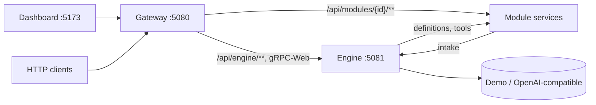

# Flowgent


**A spec-driven AI experiment.**

Flowgent is a base for building LLM workflows. Workflows are described in YAML (steps, transitions, prompts, JSON schemas, rules, human review, demo responses) and run by a domain-agnostic engine on **Microsoft Agent Framework Workflows**. Each business domain is a **module**: a small service that owns its definitions and custom code. A generic dashboard monitors every module, and one command starts everything.

- **Engine**: validates and runs workflows, owns runs, events, the inbox, human input, LLM access (Demo or OpenAI-compatible) and telemetry.
- **Modules**: publish their definitions and expose tools (C# operations called by workflow steps) and domain endpoints.
- **Gateway**: the single entry point for the dashboard and clients.
- **Dashboard**: adapts to the selected workflow (graph, form, approvals, runs, agents, events).
- **Demo mode** by default: no API key needed, every workflow runs offline with the responses declared in YAML.

## Topology



Details: [Architecture](docs/architecture.md).

## Modules

| Module | Folder | Description |
|--------|--------|-------------|
| Support | [`modules/support`](modules/support/README.md) | Reference module: triages support emails and proposes code fixes after human approval. |
| Jokes | [`modules/jokes`](modules/jokes/definition/module.yaml) | Tiny example: one `llm` step turns a topic into a one-liner joke. A good starting point to read. |
| Template | [`modules/_template`](modules/_template/README.md) | Minimal module to copy when creating a new one (disabled by default). |

A test-only fixture module (`backend/tests/Fixtures/Flowgent.Fixtures.Module`) covers every step kind in the integration tests.

## How modules work

1. A module folder contains `definition/` (`module.yaml`, `workflows/`, `prompts/`, `schemas/`, `samples/`), `service/` (ASP.NET Core on `Flowgent.Module.Sdk`), `tests/` and its documentation.
2. The module service publishes its definition files at `GET /_module/package`. The engine polls every configured module, validates the definitions and compiles each workflow into an Agent Framework graph.
3. A client submits an input to `POST /api/engine/workflows/{id}/runs` (or to a module endpoint that forwards it). The engine validates it against the input schema, stores it in the inbox and returns `202`.
4. The run executes step by step: `llm`, `rule`, `map`, `human-input`, `tool` (calls the module service), `http` (calls an external API) and `terminal`.
5. Every transition is persisted and streamed to the dashboard.

A minimal workflow (shortened from [`template-hello.yaml`](modules/_template/definition/workflows/template-hello.yaml)):

```yaml
id: template-hello
version: 1
name: Hello (template)
input:
  schema: { file: schemas/template-hello.input.schema.json }
start: summarize
steps:
  - id: summarize
    kind: llm
    name: Summary
    prompt: { file: prompts/summarize.user.md }
    output: { schema: { file: schemas/summary.schema.json } }
    demo:
      output: { summary: "[Demo] {{ input.text | string.truncate 80 }}" }
    next: count_words
  - id: count_words
    kind: tool
    name: Word count
    tool: template.wordCount
    input: { text: "{{ steps.summarize.summary }}" }
    next: done
  - id: done
    kind: terminal
    name: Done
    outcome: success
    message: "{{ steps.summarize.summary }} ({{ steps.count_words.words }} words)"
```

To add a module, copy `modules/_template` and follow its README: no change to the engine, the gateway code or the dashboard is needed. See [Module authoring](docs/module-authoring.md).

## Getting started

Requirements: .NET 10 SDK, Node.js 20.19+.

```bash
git clone <repository-url> flowgent
cd flowgent
cd dashboard && npm install && cd ..

# Engine, enabled modules, gateway and dashboard (.NET Aspire)
dotnet run --project backend/src/AppHost/Flowgent.AppHost
```

| What | Where |
|------|-------|
| Monitoring dashboard | http://localhost:5173 |
| Gateway (API entry point) | http://localhost:5080 |
| Aspire dashboard (logs, traces, metrics) | http://localhost:15080 |

Enable the template module with `-- --AppHost:Modules:template:Enabled=true`. Services can also be started one by one; see [Orchestration](docs/orchestration.md).

The engine starts in Demo mode. To use a real model, set `Flowgent:Llm` in the git-ignored `backend/src/Services/Flowgent.Engine.Service/appsettings.Development.json` or in environment variables; see [Demo mode](docs/demo-mode.md).

### Build and test

```bash
dotnet build backend/Flowgent.slnx
dotnet test --solution backend/Flowgent.slnx          # engine, gateway, architecture, integration and module tests

cd dashboard
npm run typecheck
npm run test -- --run
npm run build
```

Tests run in-process (`Flowgent.Testing.PlatformHarness`): no ports, no Aspire, Demo mode.

## Repository structure

```
global.json                         # .NET test runner (Microsoft.Testing.Platform), read from the working directory
backend/
├── Flowgent.slnx                   # single solution (backend and modules)
├── Directory.Build.props, Directory.Packages.props, nuget.config   # shared build settings and package versions
├── schemas/                        # JSON Schemas of the YAML formats
├── protos/run_monitor.proto        # gRPC run stream
├── src/
│   ├── Engine/                     # Flowgent.Contracts, .Definitions, .Runtime, .Persistence
│   ├── Services/                   # Flowgent.Engine.Service, Flowgent.Gateway
│   ├── Sdk/                        # Flowgent.Module.Sdk, Flowgent.Testing
│   └── AppHost/                    # Flowgent.AppHost, Flowgent.ServiceDefaults
└── tests/                          # Engine, Gateway, Architecture, Integration tests, Fixtures/
modules/
├── _template/                      # module template
├── jokes/                          # tiny example module (single llm step, no tools)
└── support/                        # support module (definition, service, tests, dummy-apps, docs)
dashboard/                          # React monitoring console
docs/                               # platform documentation
```

## Tech stack

| Area | Technology |
|------|-----------|
| Runtime | .NET 10, C# latest |
| Execution | Microsoft Agent Framework Workflows 1.27 |
| LLM | Microsoft.Extensions.AI `IChatClient` (Demo, OpenAI-compatible) with structured output |
| Definitions | YAML (YamlDotNet), Scriban templates, JSON Schema (JsonSchema.Net) |
| Services | ASP.NET Core minimal APIs, YARP gateway, gRPC-Web |
| Orchestration | .NET Aspire 13, OpenTelemetry |
| Persistence | EF Core 10 InMemory |
| Frontend | React 19, TypeScript 6, Vite 8, Tailwind CSS 4, React Flow, dagre |
| Testing | xUnit v3 (Microsoft.Testing.Platform), FsCheck, NSubstitute, NetArchTest, Vitest, fast-check |

## Documentation

| Document | Content |
|----------|---------|
| [Architecture](docs/architecture.md) | Services, contracts, module catalog, run model, persistence, dependency rules |
| [Workflow reference](docs/workflow-reference.md) | `module.yaml`, workflows, every step kind, samples, validation |
| [Expressions](docs/expressions.md) | Scriban templates and conditions, available data, sandbox |
| [Module authoring](docs/module-authoring.md) | Creating a module from the template: SDK, tools, endpoints, registration, tests |
| [Gateway](docs/gateway.md) | Routes, configuration, correlation id, 503 handling |
| [Engine API](docs/engine-api.md) | `/api/engine` endpoints, gRPC stream, engine configuration |
| [Demo mode](docs/demo-mode.md) | LLM providers and demo responses |
| [Inbox](docs/inbox.md) | Asynchronous intake and processing |
| [Human input](docs/human-input.md) | Approve, reject and abort |
| [Dashboard](docs/dashboard.md) | Pages, graph, form, real-time updates |
| [Orchestration](docs/orchestration.md) | AppHost, standalone services, observability |
| [Debugging](docs/debugging.md) | `.http` files, troubleshooting, traces |

## License

This project is licensed under the MIT License. See [LICENSE](LICENSE) for details.
