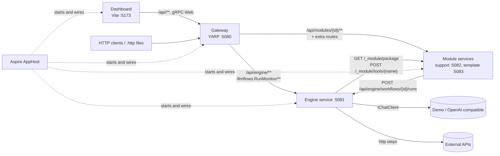
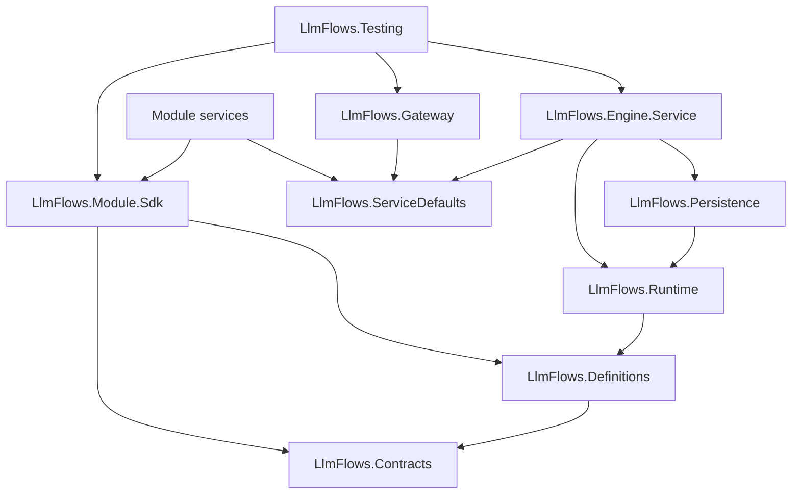

# Architecture

[← README](../README.md) · [Workflow reference](workflow-reference.md) · [Engine API](engine-api.md) · [Gateway](gateway.md)

LlmFlows is a small distributed platform that runs LLM workflows described in YAML. The engine knows nothing about business domains: every domain lives in a **module service** that owns its definitions and custom code.

## Topology



| Component | Project | Responsibility |
|-----------|---------|----------------|
| Gateway | `LlmFlows.Gateway` | Single public entry point. Config-driven YARP routes, gRPC-Web passthrough, correlation id, `503` problem details. See [Gateway](gateway.md). |
| Engine service | `LlmFlows.Engine.Service` | Pulls module packages, validates and compiles workflows, runs them on Microsoft Agent Framework Workflows. Owns runs, events, inbox, human input, LLM access (Demo or OpenAI-compatible), telemetry, the `/api/engine` API and the gRPC run stream. |
| Module services | `modules/<id>/service` (on `LlmFlows.Module.Sdk`) | Own one domain: `module.yaml`, workflows, prompts, schemas, samples, tools (HTTP operations called by `tool` steps) and domain endpoints. |
| Dashboard | `dashboard/` | Generic React console. Calls only the gateway. See [Dashboard](dashboard.md). |
| AppHost | `LlmFlows.AppHost` | .NET Aspire host: starts everything with one command and shows logs, traces and metrics. See [Orchestration](orchestration.md). |

Service-to-service calls go directly between services (by name under Aspire, by `localhost` port otherwise), never through the gateway. Every service uses `LlmFlows.ServiceDefaults`: health endpoints (`/health`, `/alive`), OpenTelemetry, service discovery and resilience for outgoing HTTP calls.

## Service contracts

Modules and the engine talk only through the HTTP contracts in `LlmFlows.Contracts`.

| Direction | Endpoint | Purpose |
|-----------|----------|---------|
| Engine → module | `GET /_module/package` | All definition files as text plus a version (SHA-256 of the files). Served with `ETag`; the engine polls with `If-None-Match` and gets `304` while nothing changed. |
| Engine → module | `POST /_module/tools/{name}` | Invokes a tool. Body `{ runId, moduleId, workflowId, stepId, input }`, response `{ output }` or `{ error }` (`404` unknown tool, `400` expected tool failure, `500` unexpected error). |
| Module → engine | `POST /api/engine/workflows/{id}/runs` | Generic intake, used by domain endpoints (`IEngineClient`). |
| Clients → module | `GET /api/modules/{id}` | Module summary (id, name, description, version, valid, workflows). |

The engine never loads module code: custom logic runs in the module process and is reached over HTTP. `/_module/*` is meant for the private network; the gateway does not route it.

## Module catalog

The engine reads the module list from `LlmFlows:Modules` and polls each module in the background (`ModuleCatalogService`), so its own startup never waits for modules.

| Status | Meaning |
|--------|---------|
| `Loading` | No fetch has completed yet. |
| `Available` | Definitions loaded and valid; new inputs are accepted. |
| `Invalid` | Validation errors or a conflict (manifest id differs from the configured id, workflow id already owned by another module). Errors are listed by `GET /api/engine/modules` and the dashboard. |
| `Unavailable` | The last fetch failed. Definitions loaded earlier are kept for in-flight runs; new inputs get `503`. Polling continues every `RefreshSeconds`. |

When a module publishes a new version, the engine loads and compiles it atomically. Runs already in progress keep the definition they started with.

## Runs

Each submitted input becomes a **run** of one workflow. A run has a current step id and a status:

| `RunStatus` | Meaning |
|-------------|---------|
| `Queued` | Saved by the intake, waiting for the inbox processor. |
| `Running` | Steps are executing. |
| `AwaitingInput` | Paused on a `human-input` step. |
| `Completed` | Ended on a `success` terminal step. |
| `Failed` | Ended on a `failure` terminal step, a step failure, or an abort. |
| `Cancelled` | Stopped by engine shutdown. |

`Completed`, `Failed` and `Cancelled` are terminal. Event kinds (`RunEventKind`): `Queued`, `StepStarted`, `StepCompleted`, `AwaitingInput`, `InputReceived`, `Completed`, `Failed`, `Cancelled`.

### Execution

- `WorkflowCompiler` builds a fresh Agent Framework workflow graph **per run**: one executor per step, bound to the run's `RunContext`. Concurrent runs never share state.
- The only message between executors is `StepMessage(NextStepId)`. Each step evaluates its own transitions and the graph routes the message to the chosen step.
- A step that fails (LLM error, schema mismatch, rule failure, tool or HTTP error, template error) ends the run as `Failed` on that step with a descriptive reason.
- A `maxSteps` guard (default 100 per run) stops loops: `Run exceeded the maximum of N steps.`
- Each step emits an OpenTelemetry activity (`ActivitySource` `LlmFlows.Runtime`) tagged with run, module, workflow and step.

### Persistence

The engine stores runs, transition events and inbox messages with EF Core InMemory (`LlmFlows.Persistence`, `EngineDbContext`). Every transition updates the run **and** appends an event in a single `SaveChanges` (dual-write), then publishes the update to the gRPC stream. Data is lost when the engine restarts.

## Repository layout

```
LlmFlows.slnx                       # one solution: platform, modules, tests
backend/
├── schemas/                        # JSON Schemas of module.yaml, workflows and samples (editors + engine)
├── protos/run_monitor.proto        # gRPC contract (engine + dashboard codegen)
├── src/
│   ├── Engine/                     # LlmFlows.Contracts, .Definitions, .Runtime, .Persistence
│   ├── Services/                   # LlmFlows.Engine.Service, LlmFlows.Gateway
│   ├── Sdk/                        # LlmFlows.Module.Sdk, LlmFlows.Testing (in-process harness)
│   └── AppHost/                    # LlmFlows.AppHost, LlmFlows.ServiceDefaults
└── tests/                          # Engine, Gateway, Integration, Architecture tests + Fixtures/ (test-only module)
modules/
├── _template/                      # minimal module to copy
└── support/                        # support-email module (reference implementation)
dashboard/                          # generic monitoring console
docs/                               # platform documentation
```

### Project dependencies



`LlmFlows.Architecture.Tests` enforces the rules:

- `Contracts` has no project references; `Definitions` references only `Contracts`.
- Engine projects and the gateway never reference `modules/` or `Fixtures/` and contain no `LlmFlows.Modules.*` types.
- Module services reference only `LlmFlows.Module.Sdk`, `LlmFlows.Contracts`, `LlmFlows.Definitions` and `LlmFlows.ServiceDefaults`.
- `Definitions` and `Runtime` do not depend on ASP.NET Core.
- Engine sources and the proto contain no domain terms of the support module.

## Security notes

- There is no end-user or service-to-service authentication. The gateway is the only intended public entry point; engine and module ports, including `/_module/*`, must stay on a private network.
- Secrets (`LlmFlows:Llm:ApiKey`, `LlmFlows:Secrets:*`) are read from configuration only and never returned by any endpoint. Keep them in user secrets, environment variables or the git-ignored `appsettings.Development.json`.
- Templates run in a Scriban sandbox (see [Expressions](expressions.md)); regexes have a 1 s timeout.
- `http` steps can call any URL written by the module author.
