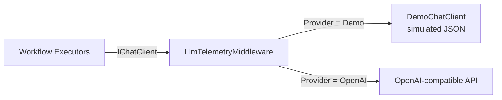

# Demo Mode

> **📚 Navigation:** [← Back to README](../README.md) | [Workflow Engine](agent-framework-integration.md) | [Dashboard](dashboard.md)

Demo mode runs the whole support pipeline **without a real LLM**: no API key, no network calls, no cost. LLM responses are simulated by `DemoChatClient`, while everything else — inbox, workflow engine, routing, agent assignment, human approval, abort, persistence, telemetry and the dashboard — runs exactly as with a real model.

It is the **default**: the backend starts in demo mode unless the provider is overridden.

---

## Enabling and Disabling

The mode is selected by `LlmProvider:Provider`:

| Value | Behaviour |
|-------|-----------|
| `Demo` (default) | Simulated responses, `ApiKey` is ignored |
| `OpenAI` | Real model through the OpenAI-compatible API (`ApiKey` required, optional `Endpoint`) |

`appsettings.json` ships with `"Provider": "Demo"`, and the same default applies when the `LlmProvider` section is missing. To use a real model, override it — typically in the git-ignored `appsettings.Development.json`:

```json
{
  "LlmProvider": {
    "Provider": "OpenAI",
    "ApiKey": "YOUR_API_KEY_HERE",
    "ModelName": "gpt-4o-mini"
  }
}
```

Any configuration source works, for example the environment variable `LlmProvider__Provider=OpenAI`. The LLM configuration is read at startup: restart the backend after changing it.

### Settings

| Setting | Default | Description |
|---------|---------|-------------|
| `LlmProvider:Provider` | `Demo` | `Demo` or `OpenAI` (case-insensitive) |
| `LlmProvider:DemoLatencyMs` | `1500` | Simulated latency of each LLM call, so the dashboard shows each stage in progress. `0` = instant |

---

## How It Works

`ChatClientSetup.AddChatClient()` registers a `DemoChatClient` instead of the OpenAI client. It implements the standard `IChatClient` interface, so the workflow executors are unaware of the difference: they still call `GetResponseAsync<T>()` with structured output, and the demo client answers with JSON matching the requested type.



### Request detection

Each email triggers three LLM calls. The demo client recognizes them from the requested JSON schema (with the prompt shape as fallback):

| Call | Detected by | Response |
|------|-------------|----------|
| Classification | default | `ClassificationResult` |
| Root cause analysis | `RootCauseDescription` in the schema, or prompt starting with `Agent:` | `ResolutionReport` |
| Code change | `SimulatedDiff` in the schema, or prompt starting with `Issue ID:` | `PullRequest` |

### Simulated responses

Responses are **deterministic**: the same email always produces the same outcome. All generated texts start with `[Demo]`.

**Classification** — keyword based, checked in this order (case-insensitive):

| Keywords in subject/body | Category |
|--------------------------|----------|
| `test`, `tests`, `flaky`, `coverage` | `QualityTestIssue` |
| `frontend`, `front-end`, `.razor`, `component`, `css`, `ui`, `button`, `render`, `display` | `FrontendBug` |
| `exception`, `error`, `crash`, `null`, `sql`, `api`, `endpoint`, `database`, `bug`, `latency`, `controller`, `injection`, `timeout` | `BackendBug` |
| none of the above | `OutOfScope` (not code-related) |

**Root cause analysis** — `AffectedComponent` is the first `*.cs` / `*.razor` file name mentioned in the email (`UnknownComponent` if none). Severity is `Critical` for `injection`/`security`, `High` for `exception`/`crash`, otherwise `Medium`.

**Code change** — a pull request titled `[Demo] Fix <component>`, touching `src/<component>`, with a small simulated diff.

Routing is **not** simulated: team routing is done by `TeamRouter` on the email text, so an email must mention `Application A` or `Application B` to get past `TeamAssigned`.

### Telemetry

Calls go through `LlmTelemetryMiddleware` like real ones. The demo client reports model `demo-simulated` and an estimated token usage (about 4 characters per token), so the Agents page shows calls, tokens and latency per agent.

---

## Expected Results with the Dashboard Templates

| Template | Final stage |
|----------|-------------|
| A1–A3, B1–B3 | `AwaitingApproval` → `CodeChangeGenerated` (Approve) or `ManualReviewRequired` (Reject) |
| Out-of-Scope | `ClassifiedOutOfScope` |
| Ambiguous Routing | `Failed` — both applications mentioned |
| Failed Routing | `Failed` — no application mentioned |
| Empty Input | Rejected by validation (form and API) |

Any in-progress issue can also be stopped with **Abort** (`Failed: Aborted by user`).

---

## In the Dashboard

`GET /api/support/config` tells the dashboard which LLM is in use:

```json
{ "sequentialProcessing": false, "demoMode": true, "llmProvider": "Demo", "llmModel": "demo-simulated" }
```

The Overview header shows a violet **Demo Mode** badge in demo mode, or a badge with the provider and model otherwise (e.g. **OpenAI · gpt-4o-mini**). The API key and endpoint URL are never exposed.

---

## Limitations

- Responses do not depend on the code in `DummyApps/`: root causes and diffs are placeholders.
- Classification is keyword-based, so unusual wording can be categorized differently than a real model would.
- Use the `OpenAI` provider to evaluate prompt quality or model behaviour.
