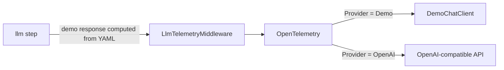

# Demo mode and LLM providers

[← README](../README.md) · [Workflow reference](workflow-reference.md) · [Dashboard](dashboard.md)

The engine owns LLM access; module services never call a model for workflow steps. Two providers exist:

| `LlmFlows:Llm:Provider` | Behaviour |
|-------------------------|-----------|
| `Demo` (default) | No model, no API key, no network. Each `llm` step answers with the response declared in its `demo:` block. |
| `OpenAI` | Any OpenAI-compatible chat API (`ApiKey` required, optional `Endpoint`). |

Everything else (inbox, runs, tools, http steps, human input, persistence, telemetry, dashboard) behaves the same in both modes.

## Settings (`LlmFlows:Llm`, engine service)

| Setting | Default | Description |
|---------|---------|-------------|
| `Provider` | `Demo` | `Demo` or `OpenAI` (case-insensitive). |
| `ModelName` | `gpt-4o-mini` | Model id used with `OpenAI`. |
| `ApiKey` | — | Required with `OpenAI`, ignored in Demo mode. |
| `Endpoint` | OpenAI | Optional absolute `http(s)` URL of an OpenAI-compatible server (e.g. Groq `https://api.groq.com/openai/v1`, Ollama `http://localhost:11434/v1`). |
| `DemoLatencyMs` | `1500` | Simulated latency per call in Demo mode, so progress is visible in the dashboard. `0` = instant. |

The configuration is read at startup. Keep the API key out of committed files: use the git-ignored `backend/src/Services/LlmFlows.Engine.Service/appsettings.Development.json`, or environment variables (`LlmFlows__Llm__Provider`, `LlmFlows__Llm__ApiKey`, …). Example `appsettings.Development.json`:

```json
{
  "LlmFlows": {
    "Llm": { "Provider": "OpenAI", "ModelName": "gpt-4o-mini", "ApiKey": "<your key>" }
  }
}
```

The AppHost can also override the provider without touching files: `dotnet run --project backend/src/AppHost/LlmFlows.AppHost -- --AppHost:LlmProvider=Demo`.

## Declaring demo responses

Each `llm` step declares its Demo response in YAML, in one of three forms. Templates work as everywhere else (see [Expressions](expressions.md)).

Static or templated output:

```yaml
demo:
  output:
    summary: "[Demo] {{ input.text | string.truncate 80 }}"
```

Ordered rules with a default (same matching as the `rule` step, first match wins, case-insensitive):

```yaml
demo:
  value: "{{ input.text }}"
  rules:
    - match: '\burgent\b|asap'
      output: { priority: high, reasoning: "[Demo] Mentions urgency." }
    - when: input.text | string.contains "later"
      output: { priority: low, reasoning: "[Demo] Can wait." }
  default: { priority: normal, reasoning: "[Demo] No signal." }
```

A module tool that computes the response (input `{ stepId, prompt, systemPrompt }`):

```yaml
demo:
  tool: notes.demoSummary
```

The demo output must still match the step's output schema: it is validated like a real response.

## How it works



In Demo mode the `llm` step evaluates the `demo:` block before the call and passes the JSON to `DemoChatClient` through `ChatOptions.AdditionalProperties`. The demo client waits `DemoLatencyMs` and returns it with model `demo-simulated` and an estimated token usage (about 4 characters per token). Calls go through the same telemetry middleware as real ones, so the Agents page shows calls, tokens and latency.

When Demo mode is active and an `llm` step has no `demo:` block, the step fails with `Step '<id>' has no demo response; Demo mode requires a demo: block.` The validator reports such steps as warnings when the module loads.

## In the dashboard

`GET /api/engine/config` returns `{ sequentialProcessing, demoMode, llmProvider, llmModel }`. The Overview header shows a **Demo Mode** badge, or the provider and model (e.g. **OpenAI · gpt-4o-mini**). The API key and endpoint are never exposed.

## Limitations

- Demo responses are as good as the rules written in YAML: they do not read the prompt.
- Use the `OpenAI` provider to evaluate prompts and model behaviour.
