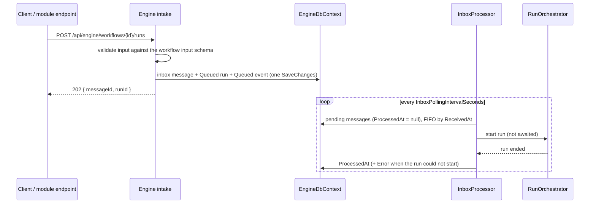

# Inbox

[← README](../README.md) · [Engine API](engine-api.md) · [Architecture](architecture.md)

Every workflow uses the same asynchronous intake (transactional inbox pattern): the request is persisted and acknowledged immediately, and a background processor starts the run.

## Intake

`POST /api/engine/workflows/{workflowId}/runs` (also used by modules through `IEngineClient`):

- `404` when the workflow is unknown, `503` when its module is not available.
- `400` when the body is not a JSON object or does not match the input schema; nothing is stored.
- Otherwise the inbox message, the `Queued` run (with its title rendered from the workflow `title` template) and its first event are saved together, and `202 { messageId, runId }` is returned.

## Processing

`InboxProcessor` is a hosted service in the engine:

- Pending messages are started in FIFO order (`ReceivedAt`).
- Runs are started without waiting for them, so a run paused on human input never blocks the inbox. Runs execute concurrently.
- No retries: a message is marked processed (`ProcessedAt`) when its run ends. If the run cannot start, for example because its workflow or module is no longer available (`Workflow '<id>' is not available.`, `Module '<id>' is unavailable.`), the run is failed and the reason is stored in `Error`.
- A run aborted while still queued is skipped (no new transition).
- On shutdown, in-flight runs end as `Cancelled` and their messages are marked processed.

## Sequential mode

With `Flowgent:SequentialProcessing = true` the processor starts a run only when no other run is `Running` or `AwaitingInput`, one message at a time. The dashboard shows a **Sequential Mode** badge on the Overview page.

## Monitoring

`GET /api/engine/inbox?status=queued|processed|failed&moduleId=` lists messages with their payload (the run input). A message is `queued` until its run ends, `failed` when it has an error, `processed` otherwise. Note that a run that ends in `Failed` because of a step is a processed message: the failure is on the run, not on the inbox. The dashboard Inbox page shows the same data.

## Configuration

| Key | Default | Description |
|-----|---------|-------------|
| `Flowgent:InboxPollingIntervalSeconds` | `5` (`1` in the engine `appsettings.json`) | Polling interval. |
| `Flowgent:SequentialProcessing` | `false` | One run at a time. |
