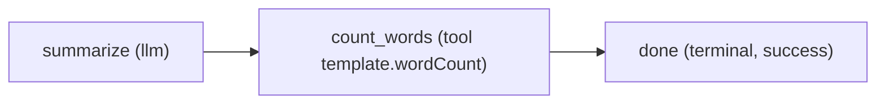

# Template module

A minimal, valid LlmFlows module to copy when you start a new one. It has one workflow, `template-hello`:



- `summarize` asks the LLM for a short summary (structured output, `schemas/summary.schema.json`). In Demo mode the engine returns the `demo:` output instead, so no API key is needed.
- `count_words` calls the module's own tool `template.wordCount` (C# code in `service/Tools/WordCountTool.cs`).
- `done` ends the run with the summary and the word count.

## Layout

```
modules/_template/
├── definition/               # published to the engine by the service (GET /_module/package)
│   ├── module.yaml           # id, config, agents, tools, workflow and sample files
│   ├── workflows/template-hello.yaml
│   ├── prompts/              # llm prompts (Scriban templates)
│   ├── schemas/              # JSON Schemas: workflow input, llm output, tool input/output
│   └── samples/              # sample inputs shown by the dashboard
├── service/                  # module service (ASP.NET Core + LlmFlows.Module.Sdk), port 5083
│   ├── TemplateHost.cs       # builds the app; used by Program.cs and by the tests
│   ├── Tools/WordCountTool.cs
│   └── template.http         # requests through the gateway
└── tests/                    # definition validation + end-to-end run in Demo mode (in-process)
```

## Run it

The template is part of the solution and the AppHost, disabled by default:

```bash
dotnet run --project backend/src/AppHost/LlmFlows.AppHost -- --AppHost:Modules:template:Enabled=true
```

Open the dashboard (http://localhost:5173), pick the module `Template` and the workflow `Hello (template)`, and submit the sample. To enable it permanently set `AppHost:Modules:template:Enabled` to `true` in `backend/src/AppHost/LlmFlows.AppHost/appsettings.json`.

Tests:

```bash
dotnet test --project modules/_template/tests
```

## Create a new module from the template

The example uses the id `notes` and the name `Notes`; replace them with yours. Ids are lowercase (`^[a-z][a-z0-9_-]*$`).

1. Copy `modules/_template` to `modules/notes`.
2. Definition (`definition/`):
   - `module.yaml`: set `id: notes`, `name`, `description`, `config` and the agents. Tool names start with the module id (`notes.wordCount`).
   - Rename `workflows/template-hello.yaml` (and its `id`) to your workflow, e.g. `notes-summary`. Workflow ids must be unique across all modules.
   - Update `samples/*.yaml` (`workflow:` and ids) and the `workflows:`/`samples:` lists in `module.yaml`.
3. Service (`service/`):
   - Rename `LlmFlows.Modules.Template.csproj` to `LlmFlows.Modules.Notes.csproj`; update `RootNamespace` and `InternalsVisibleTo`.
   - Rename `TemplateHost` to `NotesHost`, set `ModuleId`/`WorkflowId`, and replace the namespaces `LlmFlows.Modules.Template*`.
   - Register one handler per tool declared in `module.yaml`: `builder.Services.AddModuleTool<MyTool>("notes.myTool")`. The service logs an error at startup for a declared tool without a handler.
   - Pick a free port in `Properties/launchSettings.json` and update `template.http`.
4. Tests (`tests/`): rename the project and its references, then adapt `TemplateModuleTests` (content root `modules/notes/service`).
5. Register the module:
   - `LlmFlows.slnx`: add the service and test projects.
   - AppHost: add a `ProjectReference` to the service in `LlmFlows.AppHost.csproj` and `modules.Add<Projects.LlmFlows_Modules_Notes>("notes");` in `AppHost.cs` (add extra gateway routes as further arguments if the module keeps legacy URLs).
   - Without the AppHost (services started one by one): add `{ "Id": "notes", "Url": "http://localhost:<port>" }` to `LlmFlows:Modules` in the engine `appsettings.json` and `{ "Id": "notes", "Address": "http://localhost:<port>" }` to `Gateway:Modules` in the gateway `appsettings.json`.
6. Run `dotnet test --solution LlmFlows.slnx`.

No change to the engine, the gateway code or the dashboard is needed: the engine pulls the definition from the module service, the gateway routes `/api/modules/notes/**` to it and the dashboard lists the new workflows.
