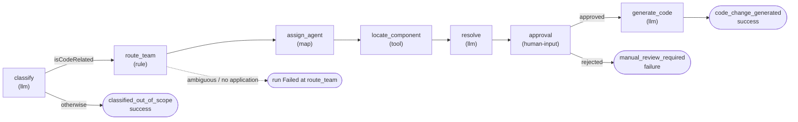

# Support module

[← Platform README](../../README.md) · [Pipeline](docs/pipeline.md) · [Demo responses](docs/demo-responses.md) · [Scenarios and dummy apps](docs/scenarios.md) · [Endpoints](docs/endpoints.md)

The support module is the reference module of Flowgent and its regression suite. Its workflow, `support-email`, triages a support email: an LLM classifies it, rules route it to a team and an agent, a tool finds the affected source file in a sample application, the agent analyses the root cause, a human approves or rejects the proposed fix and, once approved, the agent generates a simulated pull request.

It was the original hard-coded pipeline of this repository; it now runs on the generic engine, defined in YAML, with the same outcomes for every scenario.

## Pipeline



| Step | Kind | What it does |
|------|------|--------------|
| `classify` | llm | Decides whether the email reports a code defect and its category: `BackendBug`, `FrontendBug`, `QualityTestIssue` or `OutOfScope`. |
| `route_team` | rule | `Application A` → `TeamA`, `Application B` → `TeamB` (regex on subject + body). Both mentioned or neither: the run fails. |
| `assign_agent` | map | Category → role (`BackendDeveloper`, `FrontendDeveloper`, `QAEngineer`); agent id `<Team>_<Role>`, assigned to the run. |
| `locate_component` | tool | `support.locateComponent` finds the dummy-app file mentioned in the email and returns its path and content. |
| `resolve` | llm | The assigned agent analyses the root cause: description, component, severity, proposed fix, escalation. |
| `approval` | human-input | Shows the proposed fix for review. |
| `generate_code` | llm | The assigned agent writes a simulated pull request (title, description, file paths, diff). |

Terminal outcomes: `code_change_generated` (Completed), `classified_out_of_scope` (Completed), `manual_review_required` (Failed, detail = rejection reason or `Rejected`). Routing failures end the run as Failed on `route_team` with `Ambiguous routing: …` or `Cannot determine affected application: …`. Details: [Pipeline](docs/pipeline.md).

## Agents and teams

Six agents are declared in `definition/module.yaml`, one per team and role:

| Team | Backend | Frontend | QA |
|------|---------|----------|----|
| `TeamA` (ApplicationA) | `TeamA_BackendDeveloper` | `TeamA_FrontendDeveloper` | `TeamA_QAEngineer` |
| `TeamB` (ApplicationB) | `TeamB_BackendDeveloper` | `TeamB_FrontendDeveloper` | `TeamB_QAEngineer` |

The resolution and code-generation calls are attributed to the assigned agent and use its persona in the prompts; classification is not attributed to an agent.

## Human approval

The `approval` step pauses the run in `AwaitingInput` with the review title `Proposed fix: <component>` and the fields Root cause, Affected component, Severity, Proposed fix and Escalation. From the dashboard Approvals page (or the engine API):

- **Approve** → `generate_code` → `code_change_generated` (Completed).
- **Reject** (optional reason) → `manual_review_required` (Failed, detail = reason or `Rejected`).
- **Abort** → Failed with `Aborted by user`, at any step.

## Configuration

| Where | Setting | Value |
|-------|---------|-------|
| `definition/module.yaml` | `config.dummyAppsRoot` | `dummy-apps`: folder of the sample applications, relative to `modules/support`. Used by the tool, so prompts and generated paths never hard-code it. |
| `service/appsettings.json` | `Flowgent:Module:DefinitionPath` | `../definition` |
| `service/appsettings.json` | `Flowgent:Module:EngineUrl` | `http://localhost:5081` (the AppHost sets `http://engine`) |
| `service/Properties/launchSettings.json` | port | `5082` |
| AppHost | `AppHost:Modules:support:Enabled` | `true`; the gateway also routes `/api/support/{**catch-all}` to this module |

The LLM provider is an engine setting (`Flowgent:Llm`): see the platform's [Demo mode](../../docs/demo-mode.md).

## Demo responses

In Demo mode (the default) every `llm` step answers from its `demo:` block, so all scenarios run offline: classification by keyword rules, severity by keywords (`injection`/`security` → Critical, `exception`/`crash` → High, else Medium), and placeholder root cause and diff texts prefixed with `[Demo]`. Details: [Demo responses](docs/demo-responses.md).

## Dummy apps and scenarios

`dummy-apps/` holds two small sample applications with deliberate bugs, used as the codebase the support team works on:

- [`dummy-apps/application-a/BugScenarios.md`](dummy-apps/application-a/BugScenarios.md): order management, scenarios A1–A3.
- [`dummy-apps/application-b/BugScenarios.md`](dummy-apps/application-b/BugScenarios.md): user management, scenarios B1–B3.

[`definition/samples/scenarios.yaml`](definition/samples/scenarios.yaml) is the single source of the ten scenarios (A1–A3, B1–B3, Out-of-Scope, Ambiguous Routing, Failed Routing, Empty Input): the dashboard templates come from it and `service/support.http` is generated from it. Expected results: [Scenarios](docs/scenarios.md).

## Endpoints

`POST /api/support/emails` (and `POST /api/modules/support/emails`) accepts `{ sender, subject, body }`, returns `400 { error: "Subject and Body are required." }` for a blank subject or body and otherwise forwards the email to the engine intake and returns `202 { messageId, runId }`. Runs, approvals, events and agents are read from the generic `/api/engine` API. Ready-made requests: [`service/support.http`](service/support.http). Details: [Endpoints](docs/endpoints.md).

## Run and test

```bash
# Whole platform (support is enabled by default), then open http://localhost:5173
dotnet run --project backend/src/AppHost/Flowgent.AppHost

# Module tests: definition, routing, agent mapping, demo rules, tool, endpoints, support.http, parity of all scenarios
dotnet test --project modules/support/tests
```

`support.http` is checked by `SupportServiceTests.HttpFile_IsGeneratedFromTheSamples`; after changing `scenarios.yaml`, run the tests once with `UPDATE_SNAPSHOTS=1` to regenerate it.

## Layout

```
modules/support/
├── definition/
│   ├── module.yaml                       # config, six agents, support.locateComponent
│   ├── workflows/support-email.yaml
│   ├── prompts/                          # classify, resolve, generate-code (system + user)
│   ├── schemas/                          # input, classification, resolution, pull request, tool input/output
│   └── samples/scenarios.yaml            # the ten scenarios
├── service/                              # Flowgent.Modules.Support: SupportHost, email endpoints, LocateComponentTool, support.http
├── tests/                                # Flowgent.Modules.Support.Tests
├── dummy-apps/application-a|b/           # sample applications and BugScenarios.md
└── docs/                                 # this module's documentation
```

Platform documentation: [workflow reference](../../docs/workflow-reference.md), [module authoring](../../docs/module-authoring.md), [engine API](../../docs/engine-api.md), [human input](../../docs/human-input.md).
